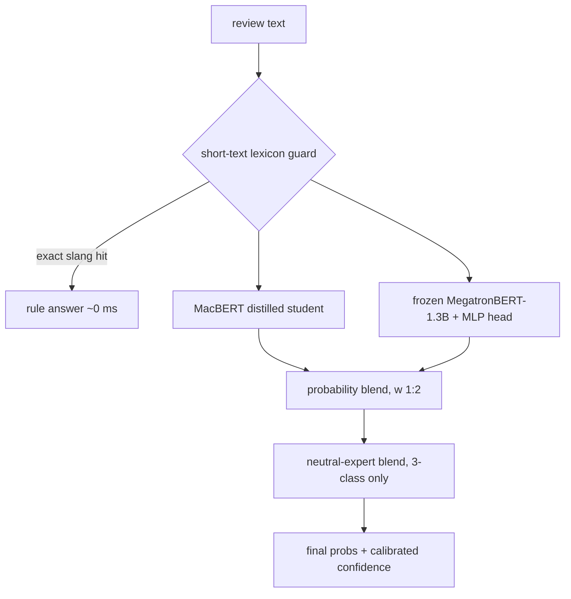

# Weakly-Supervised Chinese Review Sentiment Classification at Scale

[](thesis/thesis.pdf)
[](https://doi.org/10.5281/zenodo.24072274)
[](https://huggingface.co/spaces/Shuakami/douban-sentiment)
[](requirements.txt)
[](#license--data-note)

**Sentiment analysis for Chinese Douban reviews.** A distilled MacBERT
student plus a frozen 1.3B-parameter judge, trained on 600 hand-labelled
gold reviews and a 911K-review weakly-labelled corpus. ~80 ms per review
on a single GPU; includes a React/Vite web UI.

> **Audited release.** Strict leakage-corrected OOF: ≈83–84%
> (3-class) / 92.9% (binary). The decisive clean test is
> `data/human400_labels.jsonl` — 400 blind human annotations with
> zero known training overlap. Full audit: `paper/` (NAACL SRW
> write-up) + `thesis/`.

📄 **[Paper (PDF, 29 pages EN / 27 ZH)](thesis/thesis.pdf)** — method,
experiments, statistical tests, leakage audit, out-of-distribution
study.
Archived on Zenodo: **[DOI 10.5281/zenodo.24072274](https://doi.org/10.5281/zenodo.24072274)**
(EN + ZH PDFs and LaTeX source).
**[Live demo](https://huggingface.co/spaces/Shuakami/douban-sentiment)** on Hugging Face Spaces.

## Abstract

We study three-class sentiment classification (positive / neutral /
negative) of short Douban movie reviews under extreme label scarcity.
Starting from 600 semantic labels, we show that star ratings are poor
sentiment labels (only ~59% of 5★ reviews are semantically positive),
build a 271,905-row confident pseudo-label pool from a 910,998-review
corpus, and distill a 7-channel teacher ensemble into a single
MacBERT-base student. The deployed system — student + frozen
MegatronBERT-1.3B judge + neutral specialist — reaches **89.5%
accuracy / 85.9 macro-F1** on uncorrected 5-fold OOF (strict
leakage-corrected rerun: ≈83–84% three-class / 92.9% binary), with
neutral-class recall improved from 0.543 to 0.707. A 2,000-review out-of-distribution benchmark
(`lab2000`: 1,000 random held-out + 1,000 actively-sampled reviews, two-pass
LLM blind annotation — same model, different few-shot views — with human
adjudication of disagreements and spot
checks — 479 rows total, mixed with LLM-consensus labels) exposes a
65.0% three-class accuracy on wild short reviews; 1,000 actively-selected
AL rows lift it to 72.0%, and scaling to ~17K LLM-verified AL
rows reaches 77.1% three-class / 92.3% binary on the development set
(fusion weights selected by 5-fold cross-validation), with diminishing
returns beyond ~6K approaching the measured 71.5% second-annotator
agreement reference. On the decisive clean test — human400, 400
length-stratified blind human labels with zero known training overlap —
the frozen-weight mixture reaches **64.8%** three-class vs.\ v3's 55.8%
and a trivial star-rating lookup's 55.75% (+9.0pp, McNemar
p < 0.01).

## Results

Every score below is an out-of-fold prediction on the 600 hand-labelled
reviews: the model is scored only on reviews it never saw during training.
These are the deployed (pre-audit) scores; the strict α=1.0 rerun that
removes second-order teacher leakage reaches 83.3–84.0% three-class /
92.9% binary — see `paper/` §4 for the full decomposition.

| System | Task | Accuracy | Macro-F1 |
|---|---|---|---|
| TF-IDF + Logistic Regression | 3-class | 0.7233 | 0.6188 |
| TF-IDF + Logistic Regression | binary | 0.8406 | 0.8232 |
| Alibaba DAMO StructBERT (zero-shot) | binary | 0.8661 | 0.8459 |
| Qwen3-4B (zero-shot, label logprob) | 3-class | 0.7833 | 0.7348 |
| **Deployed system** | **binary** | **0.9587** | **0.9558** |
| **Deployed system** | **3-class** | **0.8950** | **0.8594** |

Neutral-class recall improved from 0.543 → 0.707 after adding the
corpus-trained neutral-expert pair. Warm inference latency is ~12 ms
(binary) / ~80 ms (3-class) on the target GPU; cold start ~11–15 s.

## Architecture



- Students are MacBERT models distilled from a 7-channel teacher ensemble
  (hard-label CE + soft-target KL, α=0.5, τ=2, 8 epochs).
- The judge is `IDEA-CCNL/Erlangshen-MegatronBert-1.3B-Sentiment` kept
  frozen; only a small MLP head is trained on its features.
- The neutral expert pairs a second MLP head on the same frozen backbone
  with a MacBERT neutral detector trained on ~115K pseudo-labelled
  corpus rows; its P(neutral) estimate is blended in at 0.4/0.6 weight.

## Data

| File | Contents |
|---|---|
| `data/reviews_600.jsonl` | 648 rows: 600 hand-labelled reviews + 48 ultra-short-text augmentation rows (`src:"aug"`) |
| `data/reviews_600_base.jsonl` | the original 600 rows — all reported metrics are computed on this file |
| `data/label_semantic.jsonl` / `label_rule.jsonl` | semantic labels (authoritative) vs. star-derived weak labels |
| `data/lab500_llm.jsonl` / `lab500_consensus.jsonl` | 500 fresh-corpus reviews labelled by an LLM annotator / two-annotator consensus (superseded by the lab2000 study) |
| `data/reviews_gold_al1000.jsonl` | 1,600 rows: the 600 gold reviews + 1,000 actively-selected AL reviews (279 human-adjudicated + 721 LLM-consensus labels) used for the OOD Stage-2 SFT |
| `data/aliyun/*.json` | upload files for the Alibaba Cloud PAI comparison (`scripts/to_aliyun_format.py`) |
| `data/synth_*.jsonl`, `reviews_600_synth1.jsonl`, `suspect_labels.tsv`, `audit.md` | short-text-augmentation experiment artifacts (rejected approach) and the label audit |
| `data/human400_labels.jsonl` | 400 corpus reviews, length-stratified, blind single-annotator labels — the decisive zero-overlap clean test |

Important: `label_semantic` is the ground truth. Star ratings frequently
contradict the text (e.g. 4★ reviews that are pure rants), so
`label_rule` must not be used for training or evaluation.

The label files under `data/` are our own annotation work — the 600
hand-labelled gold reviews, the 500-row fresh-corpus labelling study,
the 1,000-row actively-sampled AL set (mixed provenance: 279
human-adjudicated + 721 LLM-consensus rows), and the derived weak labels.
The full `lab2000` OOD/AL benchmark ships in `data/lab2000/`:
2,000 reviews with two-pass LLM blind labels, human adjudication of
all 335 disagreements plus 144 spot-checked agreements (479 rows;
`final_source` provenance per row), DeepSeek and
Qwen teacher labels for the ~17K scaled AL rows, fresh500, and a
per-file README. Review texts remain Douban content; the 910K corpus
is external and stays local. Annotated subsets released under `data/`
total ~5.0K reviews (gold-600, lab2000, fresh500, lab500, human400,
synth aug)
with user identifiers (nick/ip/uid/cid/timestamps) stripped; the
~16K active-learning pool texts are not redistributed. These are
research-use excerpts of Douban reviews; the platform's terms were
not licensed for this use — see the paper's Ethics section.

### Large weakly-labelled corpus

Built on the **Moviedata-10M** Douban dataset by csuldw (Central South
University, 2019) — 4.43M raw comments across 140,502 films; see the
[project repo](https://github.com/csuldw/AntSpider) (research use only,
attribution required, raw data not redistributed). We cleaned and
deduplicated it to **910,998** reviews (20,966 films, 249,105 users),
each with text, rating (1–5★), votes, timestamp. Rating→label maps
implemented in `scripts/train_bigdata.py`: `bin_strict` (1–2★→neg,
5★→pos), `bin_all` (1–2★→neg, 4–5★→pos), `tri` (3★→neutral). Star
labels are noisy in the middle range — measured on the gold set, 3★
reviews are semantically negative more often than neutral — so the
corpus is used for pretraining/pseudo-labelling, not as truth.

## Repository layout

```
scripts/    training, distillation, evaluation, big-data pipeline
web/        FastAPI backend (app.py, manifest.json, short_lexicon.py)
web-ui/     React + Vite frontend source (builds into web/static/)
web/static/ built frontend bundle served by the backend
thesis/     LaTeX source + compiled PDF + figure-generation script
data/       gold-labelled datasets
out/        OOF probability JSONs and ensemble selections (experiment logs)
models/     trained checkpoints (gitignored)
eval/       external benchmark models (gitignored)
REPRODUCE.md  maps every paper number to its artifact + regeneration command
```

## Setup

```bash
pip install -r requirements.txt
# if transformers complains about huggingface-hub:
pip install "huggingface-hub>=1.3.0,<2.0"
```

Base models needed from Hugging Face. The fine-tuned checkpoints are not
in git but are published at
[`Shuakami/douban-sentiment-weights`](https://huggingface.co/Shuakami/douban-sentiment-weights);
fetch them into place with:

```bash
python scripts/fetch_weights.py   # -> models/ (gitignored) + caches the judge backbone
```

This also downloads `IDEA-CCNL/Erlangshen-MegatronBert-1.3B-Sentiment`
(~2.6 GB, the frozen judge backbone), so the demo runs fully offline
afterwards. For retraining you additionally need `hfl/chinese-macbert-base`
(student backbone — transformers fetches it on first use).

On a flaky network use the mirror and offline mode:

```bash
export HF_ENDPOINT=https://hf-mirror.com
export HF_HUB_OFFLINE=1 TRANSFORMERS_OFFLINE=1
export HF_HOME=/path/to/hf-cache
```

## Reproducing the models

See [`REPRODUCE.md`](REPRODUCE.md) for the full number→artifact→command
map covering every result in the paper (gold-600 OOF, lab2000 OOD/AL
scaling, IAA, LLM comparisons, fresh500).

```bash
# 1) teacher OOF channels + distillation students (5-fold)
python scripts/distill.py --model hfl/chinese-macbert-base --task binary
python scripts/distill.py --model hfl/chinese-macbert-base --task 3class
python scripts/distill.py --model hfl/chinese-macbert-base --task neu

# 2) frozen-backbone features, then MLP heads (CPU)
python scripts/extract_gold_feats.py --out out/feats_mb13b_m256.npy
python scripts/distill_head.py binary out/feats_mb13b_m256.npy --tag mb13b_bin
python scripts/distill_head.py 3class out/feats_mb13b_m256.npy --tag mb13b_3c
python scripts/distill_head.py neu    out/feats_mb13b_m256.npy --tag mb13b_neu --hidden 256

# 3) production fits on 100% of the gold data
python scripts/train_final_distill.py --model hfl/chinese-macbert-base --task <task> --out models/<name>
python scripts/train_final_head.py <task> out/feats_mb13b_m256.npy --out models/<name>.pt
```

Ensemble selection/evaluation lives in `scripts/ensemble_eval.py`,
`scripts/eval_lite.py`, `scripts/eval_lite_v3.py`, `scripts/eval_neu_decomp.py`;
results are the JSONs in `out/` (e.g. `out/ens_lite_3class_v3.json` is the
deployed 3-class ensemble; `eval_lite_v3.py` regenerates it from the OOF
channel files).

### Big-corpus pipeline

```bash
python scripts/prep_bigdata.py          # raw CSV -> clean pickle (needs the raw corpus)
python scripts/train_bigdata.py --task binary --rmap bin_strict --tag <tag>
python scripts/pseudo_label.py --model models/macbert_3c_distill --tag stu3c
python scripts/train_bigdata.py --pseudo stu3c --conf 0.9 --task 3class --tag <tag>
python scripts/tfidf_bigdata.py --rmap tri --tag <tag>   # CPU baseline
```

A big-corpus checkpoint can be gold-fine-tuned through the existing
`scripts/gpu_finetune.py --model <checkpoint-dir>` (cross-validated on the
gold set).

## Running the demo

The FastAPI backend also serves the compiled frontend and the paper PDF:

```bash
cd web
export HF_HUB_OFFLINE=1 TRANSFORMERS_OFFLINE=1 HF_HOME=/path/to/hf-cache
python -m uvicorn app:app --host 127.0.0.1 --port 8000
# open http://127.0.0.1:8000  — playground, metrics, method, paper (PDF), FAQ, references
# the paper is also at http://127.0.0.1:8000/paper.pdf
```

Windows: double-click `web/start_demo.bat`. Cold start loads 3 MacBERT
students + the shared MegatronBERT backbone (~11–15 s). The API exposes
`GET /api/health`, `POST /api/predict` (`{"text": ..., "task":
"binary"|"3class"}`), `GET /api/metrics`, and `GET /api/examples`.

Frontend development:

```bash
cd web-ui && npm install && npm run dev   # dev server, proxies /api to :8000
npm run build                              # emits production bundle to ../web/static
```

## Hardware notes

Developed on an AMD RX 9070 GRE (12 GB) under ROCm — PyTorch still uses
`device="cuda"`; prefer bf16 autocast. CPU works but is 10–50× slower
for the transformer paths. TF-IDF experiments are CPU-only.

## Citation

If you use this work, please cite the paper:

```bibtex
@misc{shuakami2026douban,
  author       = {Shuakami},
  title        = {Weakly-Supervised Chinese Review Sentiment Classification at Scale:
                  Pseudo-Labeling, Specialist Decomposition, and Honest
                  Out-of-Distribution Evaluation},
  year         = {2026},
  doi          = {10.5281/zenodo.24072274},
  url          = {https://doi.org/10.5281/zenodo.24072274},
  note         = {Technical report. Code: \url{https://github.com/shuakami/douban-sentiment}},
}
```

## License / data note

Code is provided for coursework. The gold labels are hand-annotated for
this project; the external Douban corpus is research-use only and is not
redistributed here.
